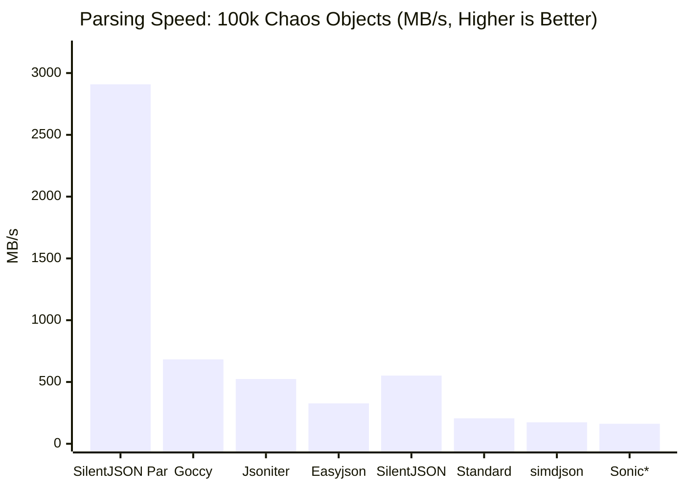
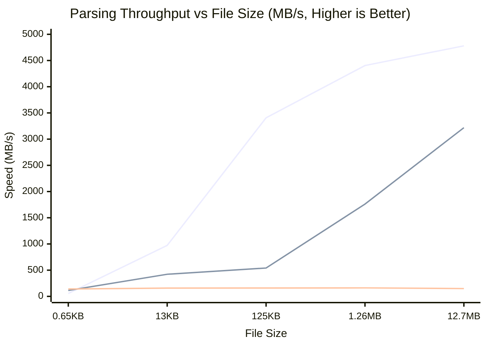
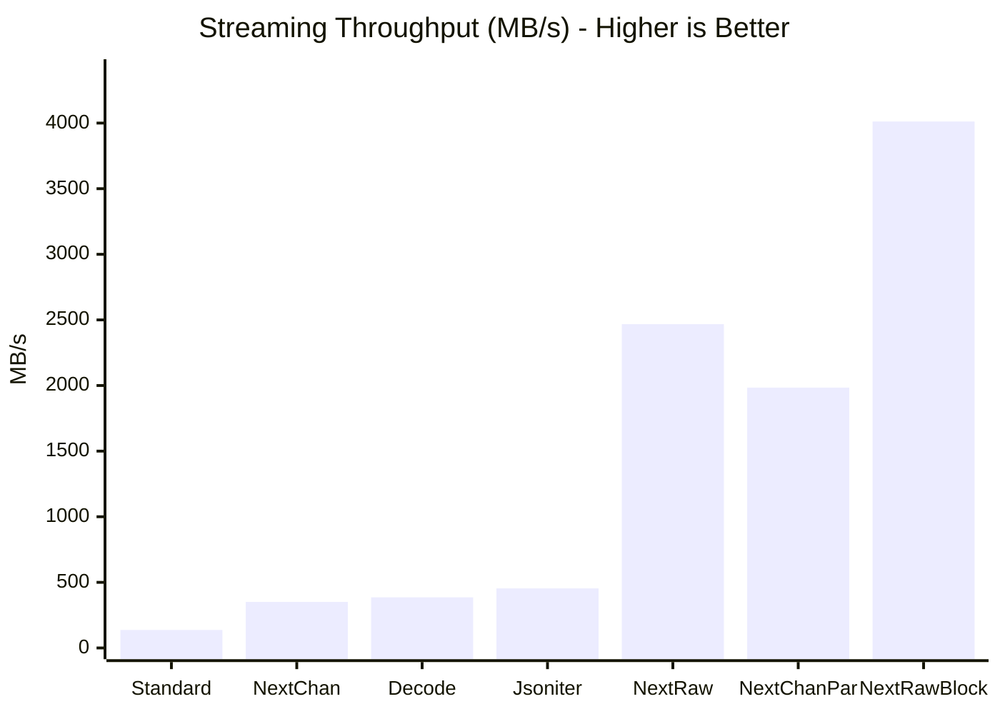
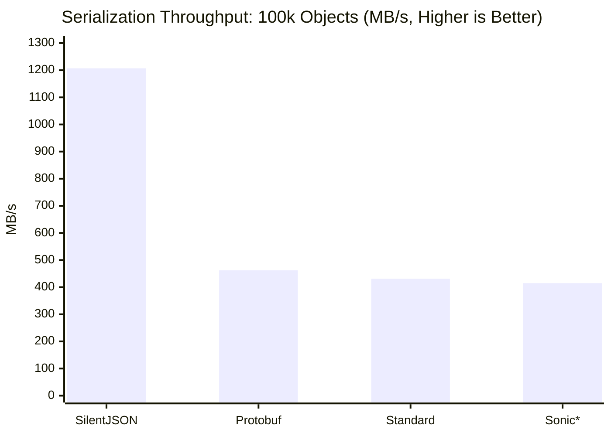
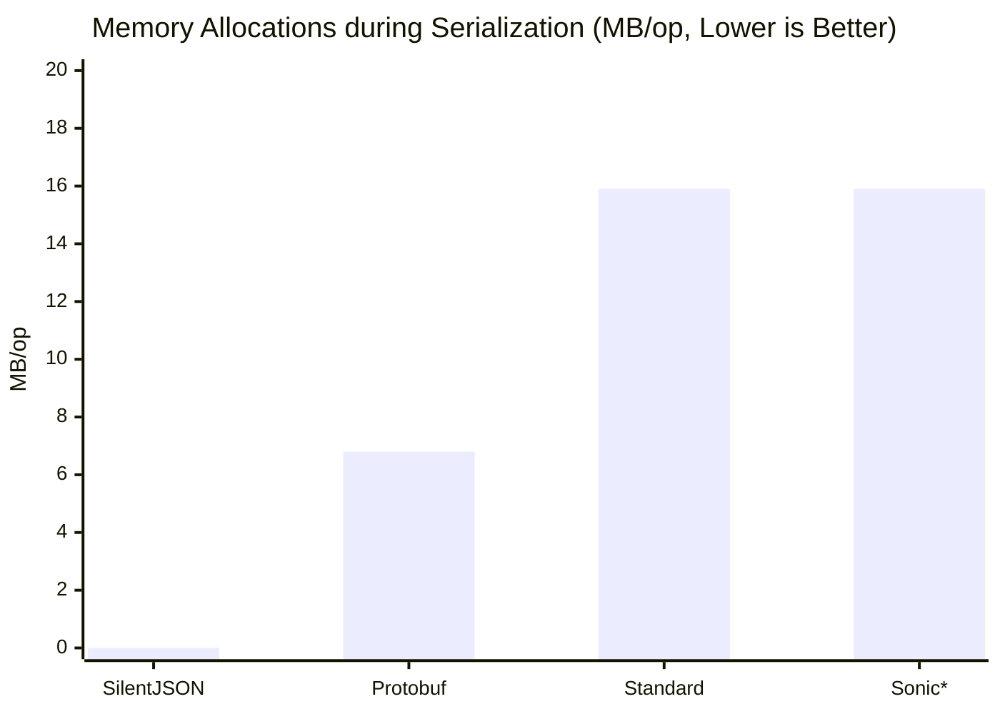

# silentjson: The "Just Works" High-Performance JSON Parser for Go

**Author: Igor Ivanuto**

[Русский](./README_RU.md) | [中文](./README_ZH.md) | [Français](./README_FR.md) | [Deutsch](./README_DE.md)

## 📰 Media & Community
* **[Habr]** [silentjson v2.0.0: Hitting the hardware limits, or how we squeezed the maximum out of JSON parsing in Go](https://habr.com/ru/news/1055022/)
* **[Reddit]** [silentjson v2.0.0: Hitting the hardware limits, or how we squeezed the maximum out of JSON parsing in Go](https://www.reddit.com/r/HiLoad/comments/1ulspzc/silentjson_v200_hitting_the_hardware_limits_or/)

[](https://pkg.go.dev/github.com/GenshIv/silentjson)
[](https://goreportcard.com/report/github.com/GenshIv/silentjson)
[](https://github.com/GenshIv/silentjson/actions/workflows/test.yml)


`silentjson` is a highly optimized, reflection-free, and zero-allocation JSON library for Go that delivers extreme performance **without requiring any code generation.**

## 🚀 Why `silentjson`?

In a world of high-performance Go libraries, `silentjson` stands out by providing massive speed boosts with zero developer friction.

- **Fast Parallel Parsing:** For large JSON arrays, `UnmarshalArrayParallel` distributes records across all CPU cores. On a Ryzen 9 7950X3D it sustains ~3.0 GB/s with full struct binding and ~1.1k allocations per 100k records — 14x faster than `encoding/json` on the same payload, with two orders of magnitude fewer allocations (see benchmarks below).
- **Fast Serial Parsing:** On a single core, `UnmarshalSlice` handles a "chaos" payload (rotating key order, unknown fields, escaped strings, nulls) at ~590 MB/s — faster than easyjson and jsoniter and 2.8x `encoding/json`, with near-zero garbage; on small or very large records it reaches 2.1-9.2 GB/s (see the shape matrix below).
- **Zero Code Generation:** This is the key. Unlike other fast JSON libraries, you don't need to generate any code. There are no extra build steps, no `go:generate` commands to remember, and no complex CI/CD pipeline configurations. **It works out-of-the-box, just like the standard library, only much faster.** This makes it trivial to integrate into any project, including those deployed in Docker or Kubernetes environments.

> [!TIP]
> **🤔 When to use SilentJSON?**
> Use this library for processing large arrays of objects where maximum throughput and minimal memory consumption are critical. However, if you require 100% strict adherence to the JSON specification for rare or non-standard edge cases, it's better to stick with the standard `encoding/json`.

## 📖 The Origin Story

This project was born out of a real-world necessity. While working on a large-scale project that required constant parsing of massive JSON catalogs, we hit a severe performance bottleneck. `easyjson` was still too slow for our specific needs, and fully integrating it would have broken our established workflows due to its code generation requirements. 

We desperately needed a lightning-fast alternative that didn't rely on JIT (Just-In-Time compilation) or code generation, but couldn't find one that met our strict requirements at the time. While there are a few alternatives available today, building `silentjson` became a personal "todo" to prove that extreme, reflection-free performance could be achieved with a clean, drop-in API.

## ⚠️ Caveats & Considerations

* **`unsafe` package:** This library heavily utilizes the `unsafe` package. Use with care.
* **AVX2 chunk splitter (history):** its escape-carry was mis-handled in assembly (a backslash in the last byte of a 32-byte SIMD block desynchronized the string state; records were silently dropped). Found and fixed in May 2026 — the AVX2 splitters are enabled and pinned by `TestSplitterEscapeCarryBoundary` / `TestSplitterMarshalDifferential`.
* **Input Buffer Immutability:** Because strings are mapped directly via zero-copy, the underlying `rawJSON` byte slice **must not be modified** while the parsed objects are still in use. This applies to **unescaped** strings only: escaped strings are always decoded into fresh allocations, and the parser never writes into the input buffer.
* **Memory Retention (Zero-Copy Side Effect):** Because strings hold direct references to the original `rawJSON` buffer, retaining even a single parsed string in memory will prevent the entire underlying JSON byte array from being garbage collected. If you only need to store a small subset of parsed data for a long time, explicitly copy the strings (e.g., using `strings.Clone(val)`).
* **Strictness vs `encoding/json`:** numbers, escapes and trailing data are validated like the standard library, but two laxnesses remain: raw control characters inside string literals are accepted (the standard library rejects them) and invalid UTF-8 bytes pass through unchanged (the standard library substitutes U+FFFD).
* **Unsupported field kinds fail loudly:** structs containing `interface{}`, `map`, `uint`/`uint64`, `chan` or `func` fields produce a registry build error (`Registry.Err()`); `Marshal` panics with a descriptive message. Check the registry once at startup.
* **CPU Usage (Parallel Parsing):** `UnmarshalArrayParallel` is designed to use all available CPU cores to maximize speed for large payloads. It is ideal for batch processing or data pipelines. Avoid using it inside individual, high-concurrency API handlers, as this can lead to excessive goroutine creation. For per-request parsing, `UnmarshalSlice` is the better choice.
* **CPU Architecture Requirements:** The `amd64` implementation uses **AVX2** instructions for value/string scanning when available and falls back to a pure Go scalar implementation otherwise (the array splitter currently always uses the scalar path — see above). The `arm64` implementation is in an **experimental/fallback state**.

## Performance Deep Dive

> **Measured on:** AMD Ryzen 9 7950X3D (32 threads), Linux, Go 1.26. All numbers are medians of 3 runs; every benchmark loop checks errors, so what is measured is real decoding work — never a fast-failing error path.
>
> **Important, May 2026 re-measure:** while making the benchmarks error-checked we found that the previously published multi-GB/s parallel numbers were invalid — the AVX2 chunk splitter silently corrupted arrays containing escaped quotes, and the benchmarks discarded the resulting errors. The assembly escape-carry bug is now **found and fixed** (see CHANGELOG): with the repaired AVX2 splitter, parallel parsing reaches ~3.0 GB/s and the stream paths fully recover (NextRawBlock ~4.0 GB/s). The tables below are the honest, error-checked, correctness-gated numbers. `sonic` runs in its fallback mode on this particular machine (its own init warns), so its rows do not represent native JIT performance.

### 1. Deserialization (Parsing / Unmarshal)

Every parser decodes the identical ~16 MB payload: 100,000 `Employee` records in "chaos" mode — rotating key order, unknown fields, escaped strings, empty arrays and nulls (`BenchmarkParserComparison`, `TestParserComparisonCorrectness` verifies every decoder against `encoding/json` field-by-field).

| Library | Objects/sec | Throughput (MB/s) | Latency (ms/op) | Allocated | Allocs/op |
| :--- | :--- | :--- | :--- | :--- | :--- |
| **SilentJSON** (Parallel) | **17.8M** 👑 | **2909** 👑 | **5.7** 👑 | **~290 KB** 👑 | **~1150** 👑 |
| Goccy | 4.1M | 671 | 24.4 | 16.5 MB | 1 |
| Jsoniter | 3.2M | 524 | 38.2 | 70.9 MB | 954k |
| **SilentJSON** (Serial) | 2.0M | 552 | 28.9 | **~130 KB** 👑 | **~1030** 👑 |
| Easyjson (codegen) | 2.0M | 322 | 50.7 | 15.4 MB | 534k |
| Standard (`encoding/json`) | 1.26M | 206 | 79.4 | 1.6 MB | 108k |
| simdjson-go (AST + manual extraction) | 1.0M | 171 | 95.6 | 306 MB | 1.4M |
| Sonic* | 1.0M | 163 | 100.6 | 67.8 MB | 108k |

\* fallback mode on this machine.

On a clean payload (`BenchmarkLargeScaleComparison`, 100k records): **SilentJSON Parallel 2985 MB/s** vs Protobuf 246, Standard 202, buger/jsonparser 178, Sonic* 159.

> [!NOTE]
> **What about `simdjson-go`?**
> `simdjson-go` is a C++ port utilizing SIMD instructions, but its API is purely AST-based: mapping into structs is manual (`FindKey` + typed getters per field), and the `As*()` helpers it needs to fill Go slices allocate heavily (306 MB per 16 MB payload in the run above). SilentJSON's parallel struct binding is ~17x faster end-to-end on this payload while keeping the `encoding/json`-style API — no code generation, no manual extraction.
>
> **Developer Experience Comparison:**
> | Approach | Libraries |
> | :--- | :--- |
> | **Struct-mapping (automatic)** | SilentJSON, Sonic, `encoding/json` |
> | **Codegen required** | easyjson |
> | **AST-only (manual)** | simdjson-go, buger/jsonparser |



#### Payload flavors: what do escapes and UTF-8 actually cost?

The same 100k-record array rendered three ways (`BenchmarkPayloadFlavors`) separates the payload properties. The parser does UTF-16/UTF-8 work only on the `\uXXXX` branch of an escaped string; multibyte-but-unescaped text takes the zero-copy path with no unicode validation:

| Flavor (100k records) | SilentJSON Serial | SilentJSON Parallel | Standard |
| :--- | :--- | :--- | :--- |
| clean (plain ASCII) | 627 MB/s | 3066 MB/s | 210 MB/s |
| escaped (10% of strings contain `\"`/`\\`) | 613 MB/s | 3254 MB/s | 206 MB/s |
| utf8 (multibyte runes: `Варшава_中央_łąka`) | 634 MB/s | 3320 MB/s | 207 MB/s |

Takeaways, measured: escapes cost throughput nothing on this parser (they only add allocations for the decoded strings — ~1.2 MB per 16 MB payload), multibyte UTF-8 is free (the scanner looks for `"` and `\` bytes only), and the pre-audit tree could not even complete the escaped row — it failed with a chunk-boundary error (see the splitter fix in the CHANGELOG).

#### Record shapes: many small vs few large vs very large

`BenchmarkShapeComparison` decodes ~14-20 MB of JSON in four record shapes with every parser (small: 500k × 40 B; medium: 100k × 160 B; large: 1k × 14 KB; huge: 8 × 2 MB with a 1.2 MB string, 2048 tags and 4096 scores). Every decoder is verified against `encoding/json` per shape before it is measured (`TestShapeComparisonCorrectness`). With the AVX2 string scanner active (every parser gets an identical loop: a destination preallocated before the timer and reused across iterations; no sink is needed — the calls are opaque and their errors are checked, so nothing can be optimized away):

| Parser (MB/s) | Small | Medium | Large | Huge |
| :--- | :--- | :--- | :--- | :--- |
| **SilentJSON Serial** | 2169 | 623 | 3895 | **9058** 👑 |
| **SilentJSON Parallel** | **3771** 👑 | 3322 | 3867 | 8995 |
| Easyjson (codegen) | 384 | 339 | 1580 | 5974 |
| Goccy | 955 | 639 | 1313 | 1461 |
| Jsoniter | 560 | 442 | 1187 | 1617 |
| simdjson-go (AST) | 173 | 170 | 1037 | 2257 |
| Standard (`encoding/json`) | 211 | 208 | 788 | 1268 |
| Sonic* | 165 | 163 | 476 | 658 |

\* fallback mode on this machine. Parallel numbers on the 100k-record shapes carry ±7% run-to-run noise.

Shape effects worth knowing: on many small records SilentJSON's registry-based decoder is untouchable (5x the nearest reflection parser); on very large records the string scanner dominates and the AVX2 implementation decides the ranking — it lifted huge-record parsing 4.7x (1935 → 9180 MB/s), putting silentjson ahead of even code-generated easyjson there.

### Hardware Flexibility (AVX2 vs Pure Go Scalar)
`silentjson` detects CPU features at runtime: AVX2 accelerates value skipping, space scanning and string appending when present; everything else falls back to an optimized pure Go implementation, so the library **never crashes** on older hardware.

The AVX2 chunk splitter is back after its escape-carry repair (May 2026) and delivers a 2.2x advantage over the pure Go path — the regression tests in `splitter_regression_test.go` pin its boundaries against a reference scanner, so a repeat of the silent-corruption bug cannot ship again:

| Library | Mode | Throughput (MB/s) | Latency (ms/op) | Allocs/op |
| :--- | :--- | :--- | :--- | :--- |
| **SilentJSON** | AVX2 (SIMD splitter + kernels) | **3025** ⭐ | 5.3 | 10120 |
| **SilentJSON** | Scalar (Pure Go) | **1400** | 11.3 | 10120 |
| Sonic* | fallback | 159 | 100.2 | 220k |
| Standard | Pure Go | 202 | 78.5 | 220k |

\* fallback mode on this machine.


### Scalability Across File Sizes (< 1 KB to 12.7 MB)
Throughput of the parallel decoder and the streaming `NextRawBlock` stays flat as the payload grows — no degradation at scale, and the streaming path holds ~1.4 GB/s from 120 KB upward (`BenchmarkSizeScalability`):

| Payload | SilentJSON Parallel | SilentJSON Stream (NextRawBlock) | Standard | Sonic* |
| :--- | :--- | :--- | :--- | :--- |
| 0.65 KB (5 objects) | 113 MB/s | 56 MB/s | 141 MB/s | 105 MB/s |
| 13 KB (100) | 422 MB/s | 972 MB/s | 158 MB/s | 121 MB/s |
| 125 KB (1k) | 541 MB/s | 3407 MB/s | 160 MB/s | 127 MB/s |
| 1.26 MB (10k) | 1761 MB/s | 4404 MB/s | 162 MB/s | 123 MB/s |
| 12.67 MB (100k) | 3218 MB/s | 4780 MB/s | 149 MB/s | 124 MB/s |

\* fallback mode on this machine. On tiny payloads per-call overhead dominates; from ~1 MB the parallel decoder reaches its AVX2-splitter steady state.



> **Legend:**
> 🔵 **Top Line:** `SilentJSON` stream (NextRawBlock, ramps to ~4.8 GB/s)
> 🟣 **Middle Line:** `SilentJSON` parallel struct binding (ramps to ~3.2 GB/s)
> 🔴 **Bottom Line:** `Standard` (~150 MB/s)

### 2. Stream Parsing (io.Reader)
When you are downloading gigabytes of JSON arrays over the network and want to parse them on-the-fly without loading the entire payload into RAM, you need a streaming parser.

Because `simdjson` and `sonic` (for standard arrays) require the **entire** payload in memory, they cannot perform streaming array processing. `SilentJSON` includes a specialized `StreamDecoder` that uses an optimized boundary scanner to process infinite streams. Measured on a 500 MB stream of 3M chaos-mode records (`BenchmarkStreamComparison`):

| Library / Mode | Throughput (MB/s) | Allocated | Allocs/op | Notes |
| :--- | :--- | :--- | :--- | :--- |
| **SilentJSON (NextRawBlock)** | **4012** 🚀 | **~0.6 MB** | **5.7k** | Bulk raw chunk extraction, near-zero alloc |
| **SilentJSON (NextRaw)** | **2468** 🚀 | 527 MB | 3.0M | Per-object raw chunk extraction |
| **SilentJSON (NextChanParallel)** | **1984** 🚀 | 309 MB | 37.2M | Async producer-consumer, 16 workers |
| Jsoniter (Stream) | 454 | 149 MB | 14.6M | 2x more GC pressure than NextRawBlock |
| **SilentJSON (Next)** | **386** 👑 | **263 MB** 👑 | 37.5M | Full struct binding, reusable object |
| **SilentJSON (Decode)** | 386 👑 | 263 MB | 37.5M | Full struct binding |
| **SilentJSON (NextChan)** | 351 | 263 MB | 37.5M | Async producer-consumer |
| Standard (`json.NewDecoder`) | 137 | 107 MB | 5.1M | Slowest of the group |



*Note: full struct binding over a stream decodes strings into fresh allocations (the decoder's internal buffer is overwritten by the `io.Reader`, so zero-copy aliases would dangle) — that is the dominant cost of Decode/Next/NextChan at ~390 MB/s. `NextRawBlock()` skips struct binding entirely and extracts raw object chunks at ~4.0 GB/s with near-zero allocations; `NextChanParallel` overlaps worker parsing with I/O for ~2 GB/s with binding.*


### 3. Serialization (Generation / Marshal)
We benchmarked generating a JSON array of 100,000 complex objects (`BenchmarkLargeScaleGeneration`). `simdjson-go` is excluded as it is a parser only.

| Library | Throughput (MB/s) | Latency (ms/op) | Allocated | Allocs/op |
| :--- | :--- | :--- | :--- | :--- |
| **SilentJSON** | **1207** 👑 | **13.2** 👑 | **0 (Zero-Alloc)** 👑 | **0** 👑 |
| Protobuf | 462 | 14.7 | 6.8 MB | 1 |
| Standard (`encoding/json`) | 431 | 37.8 | 15.9 MB | 3 |
| Sonic* | 415 | 38.4 | 15.9 MB | 5 |

\* fallback mode on this machine.



### Benchmark Methodology & Fairness

To ensure our benchmarks are as fair and accurate as possible, we strictly adhere to the following principles:

1. **Setup is never measured**: payload generation, type registries, destination buffers, Protobuf conversions and reusable parser objects are created before `b.ResetTimer()`; the timed loop contains only the work being benchmarked. The parser treats its input as read-only (pinned by `TestFixNoInputMutation`), so payloads are shared without defensive copies.
2. **Errors are checked**: every benchmark loop fails on the first error. This matters — silently discarding errors once hid a chunk-splitter bug behind multi-GB/s numbers that were actually measuring a fast-failing path.
3. **Correctness gates the numbers**: `TestParserComparisonCorrectness` decodes the comparison payload with every benchmarked parser and verifies the result against `encoding/json` field-by-field. A benchmark that decodes the wrong thing is not a benchmark.
4. **Realistic Workloads**: the comparison payload uses rotating key order, unknown fields, escaped strings, empty arrays and nulls — not trivial objects. easyjson participates via real generated code (`benchpayload/`, `-no_std_marshalers` so other parsers keep their own paths).
5. **Known environment bias**: `sonic` runs in fallback mode on the benchmark machine (its init prints a warning); its rows understate its native JIT performance. All numbers are machine-specific — re-run `go test -bench . ./...` on your own hardware.



## ⚙️ Key Features

- **Fast Bulk Decoding**: ~3.0 GB/s parallel struct binding on a 16 MB payload with ~1.1k allocations per 100k records, and ~4 GB/s streaming raw-chunk extraction.
- **Zero-Copy Architecture**: Maximizes performance and minimizes GC overhead through direct `[]byte` mapping.
- **Cross-Platform**: SIMD-level acceleration for `amd64` (AVX2) with a robust Scalar fallback. **Experimental ARM64 support** is available for Apple Silicon and Linux ARM.
- **Effortless Integration**: Drop-in `UnmarshalArrayParallel` function that is fully compatible with native `[]struct{}` types.
- **Developer Friendly**: No code generation (`go generate`) required.
* **AVX2 & NEON Tape-Scanner:** Utilizes a Bitmask Iterator and SIMD instructions (like `simdjson`) to process JSON structures at blazing speeds without scalar loops.
* **Zero-Allocation Marshaling:** `MarshalSlice` does not allocate any heap memory, eliminating GC pressure.
* **Zero-Copy String Parsing:** Uses `unsafe.String` to map JSON string values directly from the input buffer.
* **Precomputed Registry:** Uses `reflect` only once at startup to build a structural registry, avoiding runtime reflection entirely.
* **Multi-Platform Support:** Works perfectly on Intel/AMD (AVX2 + Scalar Fallback). Includes **experimental ARM64 support** (Apple Silicon / Linux ARM64).
* **Generics Support:** Clean, modern API for slices via Go 1.18+ generics.

## 📦 Installation

```bash
go get github.com/GenshIv/silentjson
```

## 🛠️ Usage

> [!TIP]
> **Explore the Examples!**
> We provide ready-to-run examples with detailed explanations in their respective directories:
> 
> * **[Quickstart (`example/`)](example/)**: Learn the basics of parallel unmarshaling and zero-allocation stream iteration. ([Read the detailed Guide](example/README.md))
> * **[Silent-Chunker (`samples/silent-chunker/`)](samples/silent-chunker/)**: A CLI utility that demonstrates how to slice massive 10GB+ JSON streams into smaller files at ~4 GB/s without unmarshaling. ([Read the detailed Guide](samples/silent-chunker/README.md))
> 
> You can run the basic example instantly using: `go run example/main.go`

The API is designed to be simple and intuitive.

### 1. Build the Registry (Once)
This is the only setup step. It's done once at application startup to avoid runtime reflection.

```go
type Employee struct {
    ID     int      `json:"id"`
    Name   string   `json:"name"`
    // ... other fields
}

// Do this once, e.g., in an init() function
var empRegistry = silentjson.BuildRegistry(reflect.TypeOf(Employee{}))
```

### 2. Unmarshaling: Choose Your Speed

#### Standard (but 7x faster) Parsing
For general-purpose parsing, use `UnmarshalSlice`. It's a simple, fast, single-core parser.

```go
func parseData(rawJSON []byte, expectedCount int) ([]Employee, error) {
    // silentjson achieves zero allocations by requiring a pre-allocated slice
    emps := make([]Employee, expectedCount)
    emps, err := silentjson.UnmarshalSlice(rawJSON, empRegistry, emps)
    return emps, err
}
```

#### Parallel (15x faster) Parsing for Large Arrays
For large JSON arrays, `UnmarshalArrayParallel` provides a massive speedup with a remarkably simple API.

```go
import "github.com/GenshIv/silentjson"

func parseLargeArray(rawJSON []byte, expectedCount int) ([]Employee, error) {
    // Just pass a pre-allocated slice. It handles the multithreading automatically!
    // No code generation, no unsafe pointers.
    employees := make([]Employee, expectedCount)
    employees, err := silentjson.UnmarshalArrayParallel[Employee](rawJSON, empRegistry, employees)
    if err != nil {
        return nil, err
    }
    return employees, nil
}
```

#### Low-Latency IPC via Shared Memory (SHM)
`silentjson` is designed for high-frequency trading and low-latency systems. When combined with Shared Memory (SHM), it allows for **Zero-Copy Inter-Process Communication (IPC)**.

Since `silentjson` maps strings and slices directly from the input buffer without allocation, you can parse JSON messages arriving from another process via a memory-mapped file or ring buffer without any overhead.

```go
// Example using memory-mapped data from another process
func processFromSHM(payload []byte, reg *silentjson.Registry) {
    var trade Trade
    // Parse directly from SHM segment with ZERO heap allocations
    err := silentjson.ParseObject(payload, reg, unsafe.Pointer(&trade))
    if err == nil {
        fmt.Printf("Received: %s @ %.2f\n", trade.Symbol, trade.Price)
    }
}
```
Check the **[SHM Integration Example](example/shm_integration/main.go)** for a full producer-consumer implementation.

#### Stream Parsing (Infinite Arrays / Network streams)
When fetching large JSON array datasets from an API or disk without running out of RAM, use the `StreamDecoder`.

```go
func streamLargeArray(reader io.Reader) error {
    // Create decoder, which maintains a fixed-size internal buffer (e.g. 256KB)
    dec := silentjson.NewStreamDecoder[Employee](reader, empRegistry)
    
    // Use the convenient generic iterator.
    // The decoder reuses a single instance internally, minimizing allocations.
    err := dec.Next(func(emp *Employee) bool {
        // Process `emp` immediately (e.g. save to DB, print to stdout)
        fmt.Println(emp.ID)
        return true // return false to break early
    })
    
    return err
}
```

#### Extreme Stream Extraction & Chunking (NextRawBlock)
If you just need to extract JSON objects rapidly (e.g., to proxy them to a database, split large files into chunks, or filter by simple regex) without unmarshaling them into Go structs, use `NextRawBlock()`. 

This method almost completely avoids allocations during extraction and writes raw objects into massive contiguous byte arrays directly from the stream. It operates at **~4.0 GB/s** (measured on a 500 MB stream; see the streaming benchmark above).

```go
func fastChunkSlicer(reader io.Reader) error {
    dec := silentjson.NewStreamDecoder[Employee](reader, empRegistry)
    
    for {
        // Extract up to 1000 objects at once, targeting ~10MB chunks
        rawBytes, count, err := dec.NextRawBlock(1000, 10*1024*1024)
        
        if count > 0 {
            // rawBytes is a single contiguous slice containing `count` objects
            // Example: [ {"id":1}, {"id":2}, ... ] 
            // Note: the slice lacks outer '[' and ']' brackets
            processRawChunk(rawBytes) 
        }

        if err == io.EOF {
            break
        }
        if err != nil {
            return err
        }
    }
    return nil
}
```

#### Asynchronous Streaming (Producer-Consumer)
If you want to parse data on a background goroutine while simultaneously processing it on the main thread, use the asynchronous `NextChan` channel-based API. 

Unlike traditional libraries (like `jsoniter`) where writing a custom channel stream either leads to **data races** (reusing pointers) or **massive allocations** (creating new structs), SilentJSON uses an internal **Ring Buffer**. This achieves **ZERO extra allocations** while strictly avoiding data corruption, providing the perfect balance between concurrency and memory efficiency.

```go
func streamAsync(reader io.Reader) {
    dec := silentjson.NewStreamDecoder[Employee](reader, empRegistry)
    
    // Launch a background goroutine parsing objects with a channel buffer of 100
    ch := dec.NextChan(100)
    
    // Main thread processes them as they arrive
    for res := range ch {
        if res.Err != nil {
            log.Fatalf("Stream error: %v", res.Err)
        }
        fmt.Println(res.Item.ID)
    }
}
```

### 3. Marshaling (Generation)

`silentjson` also provides zero-allocation marshaling (JSON generation) which is significantly faster than the standard library.

#### Marshal a Single Object
```go
func generateJSON(emp *Employee) []byte {
    // Pre-allocate a buffer (optional, but recommended for zero-allocs)
    buf := make([]byte, 0, 1024)
    
    // buf will be expanded automatically if needed
    buf = silentjson.Marshal(emp, empRegistry, buf)
    return buf
}
```

#### Marshal a Slice (Array) of Objects
```go
func generateArrayJSON(emps []Employee) []byte {
    buf := make([]byte, 0, 1024 * 1024) // 1MB initial buffer
    buf = silentjson.MarshalSlice(emps, empRegistry, buf)
    return buf
}
```

## 🎯 Best Practices & Performance Tips

### 1. Registry Reuse (Critical for Performance)
Always build the registry **once** at startup and reuse it. Building a new registry for every request kills performance.

```go
// ✅ GOOD: Build once at startup
var empRegistry = silentjson.BuildRegistry(reflect.TypeOf(Employee{}))

func init() {
    // Application startup
    empRegistry = silentjson.BuildRegistry(reflect.TypeOf(Employee{}))
}

// ✅ GOOD: Reuse the registry
func processJSON(data []byte) ([]Employee, error) {
    emps := make([]Employee, expectedCount)
    return silentjson.UnmarshalArrayParallel[Employee](data, empRegistry, emps)
}

// ❌ BAD: Creates a new registry every call (up to 60% performance loss)
func badProcessJSON(data []byte) ([]Employee, error) {
    reg := silentjson.BuildRegistry(reflect.TypeOf(Employee{})) // WRONG!
    emps := make([]Employee, expectedCount)
    return silentjson.UnmarshalArrayParallel[Employee](data, reg, emps)
}
```

While SilentJSON with a new registry is still significantly faster than `encoding/json`, reusing the registry matters: creating a new registry for every 1000-object batch resulted in a ~60% drop in throughput compared to using a cached one in our tests.

### 2. Choosing the Right Parsing Strategy

| Use Case | Method | Speed | Notes |
| :--- | :--- | :--- | :--- |
| **Large arrays (>10k objects)** | `UnmarshalArrayParallel` | ~3,000 MB/s | Uses all CPU cores, best for batch processing |
| **Medium arrays** | `UnmarshalSlice` | ~530 MB/s | Single core, low GC pressure, good for APIs |
| **Streaming from network** | `StreamDecoder.Next` | ~390 MB/s | Fixed memory usage, perfect for APIs |
| **Streaming raw chunks** | `StreamDecoder.NextRawBlock` | ~4,000 MB/s | Highest streaming throughput, no struct binding |
| **Just extract objects** | `StreamDecoder.NextRawBlock` | 4,009 MB/s | Zero-allocation raw extraction |
| **Async processing** | `StreamDecoder.NextChan` | 446 MB/s | Ring buffer prevents data races |

### 3. Pre-allocation & Memory Management

```go
// ✅ GOOD: Pre-allocate slices for zero-alloc parsing
func efficientParsing(data []byte, count int) []Employee {
    emps := make([]Employee, count)  // Pre-allocate exactly what we need
    emps, _ = silentjson.UnmarshalSlice(data, empRegistry, emps)
    return emps
}

// ✅ GOOD: Reuse buffers for marshaling
func efficientMarshaling(emps []Employee) []byte {
    buf := make([]byte, 0, 1024*1024)  // Reusable buffer
    buf = silentjson.MarshalSlice(emps, empRegistry, buf[:0])  // Clear and reuse
    return buf
}

// ❌ BAD: Let silentjson allocate (slower)
func inefficientParsing(data []byte) []Employee {
    // No pre-allocation = extra allocations
    emps := []Employee{}
    emps, _ = silentjson.UnmarshalSlice(data, empRegistry, emps)
    return emps
}
```

### 4. String Memory & Zero-Copy Retention

Because `silentjson` uses zero-copy strings, they hold references to the original JSON buffer. Be aware of this in long-lived applications:

```go
// ✅ GOOD: Process strings immediately
func processEmployees(data []byte) {
    emps := make([]Employee, count)
    silentjson.UnmarshalSlice(data, empRegistry, emps)
    
    // Process strings while `data` is still in scope
    for _, emp := range emps {
        fmt.Println(emp.Name)  // Safe: references into `data`
    }
    // `data` can now be GC'd
}

// ⚠️ CAREFUL: Long-term storage
func storeEmployeeNames(data []byte) map[int]string {
    emps := make([]Employee, count)
    silentjson.UnmarshalSlice(data, empRegistry, emps)
    
    names := make(map[int]string, count)
    for _, emp := range emps {
        // PROBLEM: `emp.Name` still references `data` in memory!
        names[emp.ID] = emp.Name  
    }
    
    // `data` cannot be GC'd even though we've discarded `emps`
    // Solution: explicitly clone strings if you need long-term storage
    return names
}

// ✅ SOLUTION: Clone strings for long-term storage
func storeEmployeeNamesCorrect(data []byte) map[int]string {
    emps := make([]Employee, count)
    silentjson.UnmarshalSlice(data, empRegistry, emps)
    
    names := make(map[int]string, count)
    for _, emp := range emps {
        names[emp.ID] = strings.Clone(emp.Name)  // Explicit clone
    }
    return names
}
```

### 5. When to Use Parallel vs Sequential

```go
// ✅ Parallel: Perfect for batch processing
// Use when processing large datasets in background jobs
func batchProcessing(data []byte, count int) {
    emps := make([]Employee, count)
    silentjson.UnmarshalArrayParallel[Employee](data, empRegistry, emps)
    // ~2,924 MB/s throughput, uses all CPU cores
}

// ✅ Sequential: Better for API handlers (per-request parsing)
// Use in high-concurrency scenarios (many simultaneous requests)
func apiHandler(data []byte, count int) {
    emps := make([]Employee, count)
    silentjson.UnmarshalSlice(data, empRegistry, emps)
    // ~592 MB/s throughput, low latency variance
    // Why? Each request doesn't spawn N goroutines.
    // Parallel would create CPU contention under load.
}
```

### 6. Error Handling

```go
// Always check for parsing errors
data, err := ioutil.ReadFile("data.json")
if err != nil {
    return err
}

emps := make([]Employee, expectedCount)
emps, err = silentjson.UnmarshalSlice(data, empRegistry, emps)
if err != nil {
    // Handle parsing error (malformed JSON, type mismatches, etc.)
    log.Printf("Failed to parse JSON: %v", err)
    return err
}
```

## 🧪 Testing

To run the tests for `silentjson`, use the standard Go testing tools.

### Running Tests & Benchmarks
```bash
# Run all unit tests
go test -v

# Run with race detector
go test -race

# Run all benchmarks with memory stats (recommended)
go test -bench="." -benchmem

# Run specific benchmark (size scalability)
go test -bench=BenchmarkSizeScalability -benchmem
```

### Test Coverage
Our test suite includes:
- ✅ **32+ test cases** covering parsing, marshaling, and streaming
- ✅ **Edge cases**: escaped strings, nested structures, deep errors, empty arrays
- ✅ **Parallel safety**: race detector validation
- ✅ **Scalability benchmarks**: testing arrays from 5 → 100k objects (memory-safe, up to 100k max)
- ✅ **Benchmark suite**: comprehensive performance measurements vs Sonic and Standard library

### Recent Benchmark Results (May 2026, post-splitter-fix)

Current results on AMD Ryzen 9 7950X3D (medians of 3 runs, error-checked loops; see the tables above for details):

```
Parser comparison, 100k chaos objects (16 MB):
SilentJSON Parallel:  2,909 MB/s
Goccy:                  683 MB/s
Jsoniter:               524 MB/s
SilentJSON Serial:      552 MB/s
Easyjson:               327 MB/s
Standard JSON:          206 MB/s

Record shapes (serial): small 2169 / medium 623 / large 3895 / huge 9058 MB/s

Streaming, 3M records (500 MB):
NextRawBlock:         4,012 MB/s
NextRaw:              2,468 MB/s
NextChanParallel:     1,984 MB/s
Jsoniter stream:        454 MB/s
Decode (struct bind):   386 MB/s
Standard stream:        137 MB/s
```

The stream decoder dominates large-payload processing with near-zero allocations on the raw paths.

## 📝 TODO / Roadmap

- [x] **Scalar Fallback**: Implemented a pure Go scalar fallback for older processors that lack AVX2.
- [ ] **vtprotobuf Benchmarks**: Add `vtprotobuf` to the benchmark suite for a fair comparison against allocation-free protobuf parsing.

## 🤝 Contributing

Contributions are welcome! We'd love your help in making `silentjson` even faster and more robust. Feel free to open issues, suggest improvements, or submit pull requests.

## 📄 License

This project is licensed under the MIT License - see the [LICENSE](LICENSE) file for details.